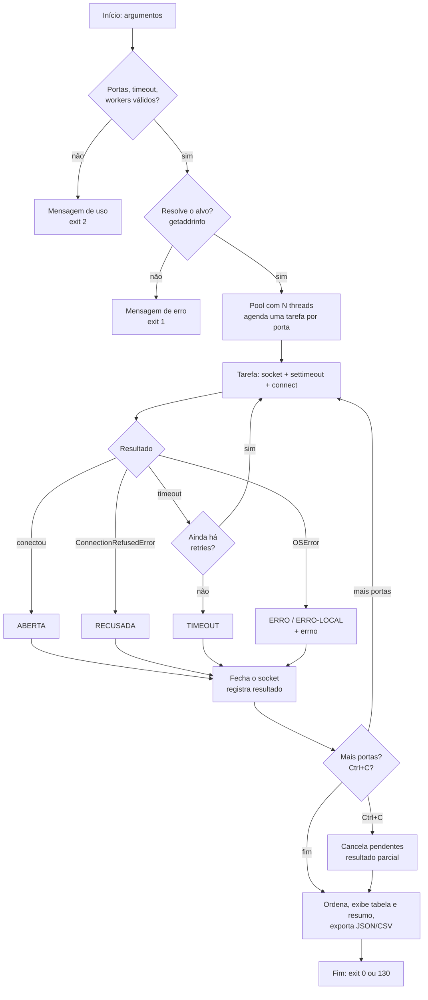

# Planejamento do scanner (seção 2)

## Estratégia

O scanner usa a técnica **TCP connect**: para cada porta, cria um socket TCP e chama
`connect()`. Quem envia os pacotes é o sistema operacional, que executa o *three-way handshake*:

```
scanner                destino
  | ---- SYN ----------> |
  | <--- SYN/ACK ------- |   porta com processo em listen()  -> connect() retorna: ABERTA
  | ---- ACK ----------> |   (o socket é fechado em seguida)
  |
  | <--- RST ----------- |   nenhum processo em listen()     -> ConnectionRefusedError: RECUSADA
  |
  |      (silêncio)      |   pacote descartado/perdido       -> socket.timeout: TIMEOUT
  |
  | <--- ICMP unreach -- |   roteador/firewall/host avisa    -> OSError (EHOSTUNREACH...): ERRO
```

Etapas do programa: (1) validar os parâmetros antes de enviar qualquer pacote; (2) resolver o
destino uma única vez; (3) testar as portas, cada uma de forma independente (uma falha não
interrompe as demais), com no máximo N tentativas simultâneas; (4) ordenar, apresentar e
exportar os resultados.

## Recursos da biblioteca `socket` utilizados

| Recurso | Uso |
|---|---|
| `socket.getaddrinfo(host, None, family, SOCK_STREAM)` | resolve IP/hostname (IPv4 e IPv6); lança `socket.gaierror` se o nome não existir |
| `socket.socket(AF_INET/AF_INET6, SOCK_STREAM)` | cria um socket TCP; usado com `with` para garantir o `close()` |
| `sock.settimeout(t)` | limita o tempo de bloqueio de `connect()`; ao estourar, lança `socket.timeout` (= `TimeoutError` no 3.10+) |
| `sock.connect((ip, porta))` | dispara o handshake; retorna em sucesso ou lança exceção |
| `ConnectionRefusedError` | RST recebido (ou ICMP port-unreachable traduzido pelo kernel) |
| `OSError.errno` + `errno.errorcode` | identifica outros erros (`EHOSTUNREACH`, `ENETUNREACH`, `EMFILE`...) |
| `socket.getservbyport(p, "tcp")` | nome convencional da porta (apenas dica) |

Alternativas consideradas e descartadas:

- `connect_ex()` devolve o errno em vez de lançar exceção, mas os valores variam entre sistemas,
  e um timeout aparece como código numérico ambíguo; o tratamento por exceções é mais legível.
- `socket.create_connection()` resolve o nome e tenta vários endereços por conta própria,
  escondendo exatamente o comportamento que queremos observar.
- `socket.setdefaulttimeout()` altera o padrão global do processo; `settimeout()` é local ao socket.

## Pseudocódigo

```
função principal(argumentos):
    portas  <- interpretar_portas(argumentos.portas)      # erro -> mensagem, sai com código 2
    validar timeout (0 < t <= 60), workers (1..1000), retries (0..5)
    ip      <- resolver(argumentos.alvo)                   # falha -> mensagem, sai com código 1
    início  <- agora()
    resultados <- []
    com um pool de N threads:
        para cada porta em portas: agendar testar(ip, porta)
        para cada tarefa concluída: resultados.adicionar(resultado)
        se Ctrl+C: cancelar tarefas pendentes; marcar como parcial; sair do laço
    ordenar resultados por porta
    exibir tabela e resumo (alvo, porta, estado, tempo, errno)
    exportar JSON/CSV se solicitado
    retornar 130 se interrompido, senão 0

função testar(ip, porta, timeout, retries):
    repetir até (1 + retries) vezes:
        estado <- tentativa(ip, porta, timeout)
        se estado != TIMEOUT: parar            # recusa/erro são respostas explícitas
    retornar estado

função tentativa(ip, porta, timeout):
    com socket TCP s:                          # fechado ao sair do bloco, em qualquer caso
        s.settimeout(timeout)
        tentar:
            s.connect((ip, porta))             -> ABERTA
        se ConnectionRefusedError              -> RECUSADA
        se timeout                             -> TIMEOUT (causa indeterminada)
        se OSError com errno local (EMFILE...) -> ERRO-LOCAL
        se outro OSError                       -> ERRO (+ nome do errno)
```

## Fluxograma



## Questão: por que uma tentativa de conexão TCP serve para investigar a disponibilidade de uma porta?

Porque o TCP exige que o destino **responda** ao pedido de abertura de conexão, e a resposta
depende de haver um processo escutando naquela porta. Se há um socket em `listen()`, a pilha
TCP do destino responde SYN/ACK e o handshake se completa. Se não há, a especificação manda
responder com RST. Assim, o resultado de `connect()` reflete diretamente o comportamento da pilha
TCP do destino para aquela porta.

O ponto de observação é a máquina que executa o scan: o que se mede é se a porta está
**acessível a partir desta origem, neste momento**. Um firewall no caminho pode descartar o SYN
(timeout), responder em nome do host (ICMP ou um RST forjado) ou um proxy/NAT pode completar o
handshake no lugar do serviço. O teste informa alcançabilidade, não identidade do serviço.
